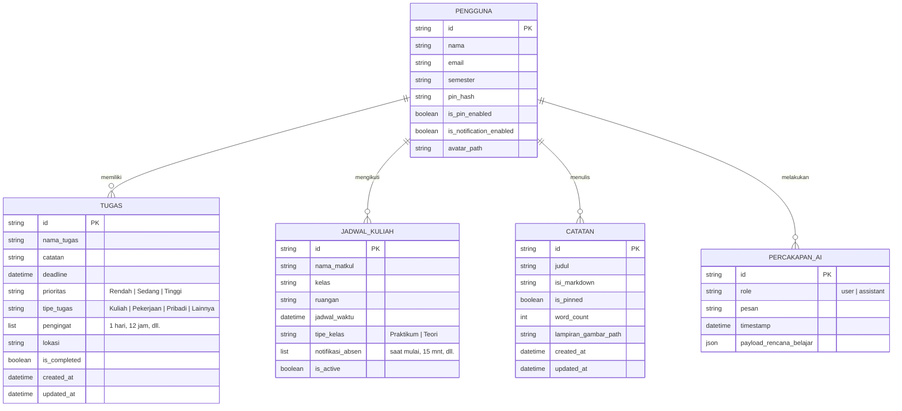

# SPESIFIKASI KEBUTUHAN FUNGSIONAL SISTEM (FUNCTIONAL REQUIREMENTS DOCUMENT)
## APLIKASI MOBILE PRODUKTIVITAS MAHASISWA: TASKFLOW MOBILE (KELARIN)

---

### INFORMASI DOKUMEN
* **Mata Kuliah**: Praktikum Pemrograman Aplikasi Mobile (Semester 5)
* **Nama Proyek**: TaskFlow Mobile / Kelarin
* **Stitch Project ID**: `12778491443419006802`
* **Desain UI**: Monochromatic Minimalist Soft-Card System (Mobile 390 × 844 px)
* **Teknologi Implementasi**: Flutter / Dart
* **Versi Dokumen**: 1.0.0
* **Status**: Disetujui berdasarkan Hasil Rancangan Antarmuka (UI/UX)

---

## 1. PENDAHULUAN

### 1.1 Deskripsi Umum Sistem
**TaskFlow Mobile** (diimplementasikan dalam modul *Kelarin*) adalah aplikasi produktivitas mobile terpadu yang dirancang khusus untuk mahasiswa tingkat perguruan tinggi. Aplikasi ini memusatkan seluruh kebutuhan akademik harian yang mencakup:
1. **Manajemen Tugas & Tenggat Waktu (Task & Assignment Management)**
2. **Presensi & Jadwal Kuliah (Class Attendance & Timetable)**
3. **Catatan Akademik Cepat (Markdown Academic Notes)**
4. **Asisten Studi Cerdas (AI Study Assistant / Tanya AI)**

Antarmuka dibangun dengan pendekatan *monochromatic minimalism* bebas saturasi warna berlebih (mengutamakan hitam `#0A0A0A`, abu-abu netral, dan kartu kontras *soft card*), bertujuan untuk mereduksi beban kognitif (*cognitive load*) mahasiswa saat mengelola jadwal dan tugas yang padat.

### 1.2 Sasaran Pengguna
* **Pengguna Utama**: Mahasiswa aktif yang membutuhkan pelacak tugas kuliah, pencatat kehadiran praktikum/teori, repositori catatan ringkas, serta asisten perencana belajar.

### 1.3 Karakteristik & Batasan Sistem
* Berjalan pada platform mobile (Android / iOS).
* Menggunakan basis tata letak responsif 390 × 844 px (*viewport standard*).
* Navigasi utama menggunakan pola *Floating Bottom Navigation* 5-slot dan *Header Unified*.
* Sistem warna строго monokrom (status prioritas dan penyelesaian dibedakan berdasarkan bobot tipografi, teks eksplisit, dan ikonografi, bukan warna merah/kuning/hijau).

---

## 2. ARSITEKTUR INFORMASI & STRUKTUR MENU

```
TaskFlow Mobile
│
├── [Modul 00] Onboarding & Splash
│   └── Splash Screen (Branding & Status Inisialisasi)
│
├── [Modul 01] Home / Overview (Tab 1)
│   ├── AppHeader (Avatar Profil, Notifikasi Bell, Tombol Tanya AI)
│   ├── PageTitleRow & Filter Waktu (Dropdown: Minggu Ini, Bulan Ini)
│   ├── StatGrid (4 Metrik: Hari Ini, Terjadwal, Prioritas, Semua)
│   ├── SearchBar (Pencarian Realtime Tugas)
│   ├── PillTabs Kategori (Semua, Hari Ini, Kuliah, Pekerjaan, dll.)
│   ├── Daftar Kartu Tugas (Prioritas Utama & Akan Datang)
│   ├── Popover Menu Tugas (Edit, Hapus)
│   └── Floating Action Menu [+]
│
├── [Modul 02] Rekap Selesai (Tab 2)
│   ├── Rekap Riwayat Tugas Terselesaikan
│   ├── Checklist & Strikethrough Status
│   └── Tombol Urungkan (Undo Completion)
│
├── [Modul 03] Presensi & Jadwal Kuliah (Tab 3)
│   ├── Presensi Aktif & Daftar Mata Kuliah
│   ├── Klasifikasi Kelas (Praktikum vs. Teori)
│   ├── Form Tambah/Ubah Jadwal Absen
│   └── Konfigurasi Pengingat Presensi
│
├── [Modul 04] Catatan Akademik (Tab 4)
│   ├── Daftar Catatan Tersimpan & Catatan Tersemat (Pinned)
│   ├── Pemilihan Template Catatan Ringkas
│   ├── Editor Catatan Baru & Ubah Catatan (Markdown Support)
│   └── Formatting Toolbar (Bold, Bullet List, Checklist, Gambar, Word Counter)
│
├── [Modul 05] Tanya AI / Asisten Studi (Modal Sheet & Chat Stream)
│   ├── Tanya AI Empty State (Panduan & Contoh Prompt)
│   ├── Percakapan Aktif (Bubble Pengguna & Bubble AI)
│   ├── Rekomendasi Jadwal Belajar Interaktif (Study Plan Card)
│   ├── Tombol Aksi Cepat "Tambahkan ke Daftar Tugas"
│   └── Quick Suggestion Action Pills
│
├── [Modul 06] Profil & Pengaturan Sistem
│   ├── Profil Pengguna (Avatar, Nama, Email Mahasiswa, Semester)
│   ├── Statistik Pencapaian (Tugas Selesai, Tugas Aktif)
│   ├── Pengaturan Keamanan (Kunci Aplikasi PIN, Ubah PIN)
│   ├── Pengaturan Notifikasi & Pengingat Global
│   ├── Pembersihan Data (Bersihkan Tugas Selesai / Arsip)
│   └── Informasi Tentang TaskFlow (Versi Aplikasi & Build)
│
└── [Modul 07] Notifikasi & Umpan Balik (Feedback)
    ├── Halaman Daftar Notifikasi Akademik
    └── Floating SnackBar / Toast dengan Aksi Urungkan (Undo)
```

---

## 3. SPESIFIKASI KEBUTUHAN FUNGSIONAL (FUNCTIONAL REQUIREMENTS)

### 3.1 Modul 00: Inisialisasi & Keamanan (Splash & PIN)

#### FR-SEC-001: Splash Screen & Inisialisasi Sistem
* **Deskripsi**: Sistem menampilkan logo TaskFlow dan melakukan pengecekan sesi autentikasi, status kunci PIN, serta pemuatan data lokal saat pertama kali dibuka.
* **Aktor**: Pengguna (Semua)
* **Prekondisi**: Aplikasi dibuka oleh pengguna.
* **Alur Normal**:
  1. Pengguna membuka aplikasi.
  2. Sistem menampilkan latar belakang kanvas `#F6F6F7`, logo aplikasi 112×112px, nama *TaskFlow*, dan slogan *"Kuliah, tugas, dan catatan dalam satu tempat"*.
  3. Indikator progress bar horizontal bergerak mengindikasikan proses loading cache.
  4. Sistem mengecek status keamanan:
     - Jika fitur PIN aktif, arahkan ke layar Input PIN.
     - Jika fitur PIN tidak aktif, langsung arahkan ke *Home (Overview)*.
* **Postkondisi**: Pengguna berhasil masuk ke antarmuka utama atau layar verifikasi keamanan.

#### FR-SEC-002: Verifikasi & Kunci Aplikasi PIN
* **Deskripsi**: Sistem mengamankan akses data tugas dan catatan pribadi melalui 4-6 digit PIN keamanan lokal.
* **Aktor**: Pengguna
* **Input**: 4–6 digit angka PIN.
* **Aturan Bisnis**:
  - Jika PIN salah sebanyak 3 kali berturut-turut, sistem memberikan jeda penundaan waktu (timeout).
  - PIN disimpan secara terenkripsi pada Secure Storage lokal perangkat (*Keystore* di Android / *Keychain* di iOS).

#### FR-SEC-003: Pengaturan dan Pengubahan PIN
* **Deskripsi**: Pengguna dapat mengaktifkan/menonaktifkan kunci PIN dan memperbarui kode PIN melalui menu Profil.
* **Aktor**: Pengguna
* **Input**: PIN Lama, PIN Baru, Konfirmasi PIN Baru.
* **Validasi**:
  - Konfirmasi PIN baru harus sama persis dengan PIN baru.
  - PIN tidak boleh berupa kombinasi angka sekuensial sederhana (misal `1234`).

---

### 3.2 Modul 01: Manajemen Tugas (Tasks & Assignments)

#### FR-TSK-001: Menampilkan Ringkasan Dashboard (StatGrid)
* **Deskripsi**: Sistem menampilkan 4 kotak metrik statistik tugas di halaman Beranda.
* **Elemen Data**:
  - *Hari Ini*: Jumlah tugas yang memiliki tenggat hari ini.
  - *Terjadwal*: Jumlah tugas yang memiliki jadwal masa mendatang.
  - *Prioritas*: Jumlah tugas berprioritas tinggi (`! Tinggi`) yang belum selesai.
  - *Semua*: Akumulasi seluruh tugas aktif.
* **Aturan Tampilan**: Menggunakan kartu grid 2×2 dengan pola selang-seling *stat-light* (`#EDEDEF`) dan *stat-dark* (`#E2E2E5`) serta ornamen grafis *sine-wave*.

#### FR-TSK-002: Filter dan Pengelompokan Tugas
* **Deskripsi**: Pengguna dapat menyaring daftar tugas berdasarkan kategori dan rentang waktu.
* **Input**:
  - Filter Rentang Waktu: Dropdown (*Minggu Ini*, *Bulan Ini*, *Semua Waktu*).
  - Filter PillTabs: Chip tombol (*Semua (N)*, *Hari Ini (N)*, *Kuliah (N)*, *Pekerjaan (N)*, *Pribadi (N)*).
* **Alur Kejadian**: Ketika salah satu pill dipilih, daftar kartu tugas di bawahnya diperbarui secara otomatis tanpa melakukan reload halaman penuh.

#### FR-TSK-003: Pencarian Tugas (Search Bar)
* **Deskripsi**: Pengguna dapat mencari tugas berdasarkan kata kunci judul, catatan, atau lokasi.
* **Input**: Teks pencarian (*query*).
* **Aturan Bisnis**:
  - Pencarian bersifat *case-insensitive*.
  - Menampilkan hasil seketika (*realtime filtering*) saat pengguna mengetik dengan *debounce* minimal 300ms.
  - Jika tidak ada hasil ditemukan, tampilkan kartu *Empty State*.

#### FR-TSK-004: Penambahan Tugas Baru (Create Task)
* **Deskripsi**: Pengguna menambahkan tugas baru ke dalam agenda.
* **Aktor**: Pengguna
* **Formulir Input**:
  1. **Nama Tugas** (`String`, Wajib/Required) - Contoh: *"Review proposal desain UI"*
  2. **Catatan Tambahan** (`Textarea`, Opsional) - Rincian deskripsi, referensi link, poin penting.
  3. **Tanggal Tenggat** (`Date Picker`, Wajib) - Format: DD MMM YYYY.
  4. **Waktu Tenggat** (`Time Picker`, Wajib) - Format: HH:mm WIB.
  5. **Tingkat Prioritas** (`Segmented Selection`, Wajib):
     - `— Rendah`
     - `= Sedang`
     - `! Tinggi`
  6. **Kategori / Tipe Tugas** (`Pill Selection`, Wajib):
     - `Kuliah`
     - `Pekerjaan`
     - `Pribadi`
     - `Lainnya`
  7. **Pengingat / Alarm Interval** (`Multi-Toggle Switch`, Opsional):
     - [ ] 1 hari sebelum
     - [ ] 12 jam sebelum
     - [ ] 6 jam sebelum
     - [x] 3 jam sebelum (Default aktif)
     - [ ] 1 jam sebelum
  8. **Lokasi** (`Text Input`, Opsional):
     - Field input teks lokasi (misal: *"Lab Komputer 3"*).
     - Tombol *"Gunakan lokasi saat ini"* (mengakses GPS perangkat dan mengisi lokasi terkini secara otomatis).
* **Validasi**:
  - Nama tugas tidak boleh kosong atau hanya berupa spasi.
  - Tanggal dan waktu tidak boleh berada di masa lampau jika pengingat diaktifkan.
* **Output / Postkondisi**: Tugas tersimpan ke database lokal, sistem memunculkan toast banner *"Tugas Berhasil Ditambahkan"*, dan menjadwalkan notifikasi lokal (*local notification*).

#### FR-TSK-005: Penyelesaian Tugas (Toggle Checkbox Task)
* **Deskripsi**: Pengguna menandai tugas yang telah selesai langsung dari daftar tugas.
* **Aktor**: Pengguna
* **Alur Normal**:
  1. Pengguna menekan tombol lingkaran checkbox (24px) di samping judul tugas.
  2. Checkbox berubah status menjadi tercentang (background hitam dengan icon ceklis putih).
  3. Judul tugas berubah warna menjadi pudar (`text-2`) dengan format coret (*strikethrough*).
  4. Tugas dipindahkan ke tab / section **Selesai (Rekap)**.
  5. Menampilkan Toast notifikasi penyelesaian dengan opsi *"Urungkan"*.

#### FR-TSK-006: Pengubahan Tugas (Edit Task)
* **Deskripsi**: Pengguna dapat mengubah seluruh rincian informasi tugas yang telah dibuat.
* **Aktor**: Pengguna
* **Prekondisi**: Pengguna menekan ikon titik tiga (⋮) pada kartu tugas lalu memilih opsi *"Edit"*.
* **Alur Normal**: Sistem membuka form *Edit Tugas* dengan data yang sudah terisi sebelumnya (*pre-populated*). Pengguna dapat memodifikasi data dan menekan tombol *"Simpan Perubahan"*.

#### FR-TSK-007: Penghapusan Tugas & Mekanisme Undo
* **Deskripsi**: Pengguna dapat menghapus tugas yang tidak diperlukan lagi.
* **Alur Normal**:
  1. Pengguna memilih menu titik tiga (⋮) -> *"Hapus"*.
  2. Kartu tugas terhapus dari tampilan utama secara langsung.
  3. Sistem memunculkan Toast di bagian bawah layar: *"Tugas Dihapus · Urungkan"*.
  4. Jika tombol *"Urungkan"* ditekan dalam kurun waktu 4 detik, tugas dikembalikan ke status semula. Jika waktu habis, tugas dihapus secara permanen atau dipindahkan ke arsip sementara.

#### FR-TSK-008: Menampilkan Rincian Tugas (Detail Tugas)
* **Deskripsi**: Menampilkan tampilan komprehensif kartu tugas, mencakup status lengkap, countdown waktu tenggat, deskripsi lengkap, lampiran, dan lokasi peta mini jika ada.

---

### 3.3 Modul 02: Rekap Tugas Terselesaikan (Completed Tasks)

#### FR-CMP-001: Menampilkan Riwayat Tugas Selesai
* **Deskripsi**: Menampilkan daftar seluruh tugas yang telah ditandai selesai secara terpisah dari tugas aktif.
* **Aturan Tampilan**:
  - Judul tugas tercoret (*strikethrough*).
  - Tanda centang terisi penuh.
  - Ikon menu titik tiga digantikan dengan tombol cepat ikon *"Undo / Kembalikan"* agar tugas dapat dipulihkan kembali ke daftar tugas aktif jika terjadi kesalahan penandaan.

#### FR-CMP-002: Pembersihan Riwayat Selesai (Batch Clean)
* **Deskripsi**: Pengguna dapat membersihkan seluruh rekap tugas selesai melalui menu pengaturan profil (*"Bersihkan Tugas Selesai"*).

---

### 3.4 Modul 03: Presensi & Jadwal Kuliah (Attendance & Class Timetable)

#### FR-ABS-001: Menampilkan Dashboard Jadwal & Presensi Aktif
* **Deskripsi**: Menampilkan jadwal mata kuliah harian dan mingguan beserta status kehadiran mahasiswa.
* **Elemen Tampilan**:
  - Nama Mata Kuliah (misal: *Pemrograman Aplikasi Mobile*, *Basis Data*).
  - Tipe Kuliah: Label pill *"Praktikum"* (background hitam) atau *"Teori"* (background abu-abu).
  - Waktu & Hari pelaksanaan (misal: *Senin, 08:00 - 10:30 WIB*).
  - Ruangan / Lab (misal: *Lab Komputer 3*).
  - Status Pengingat Presensi: Indikator bel aktif.

#### FR-ABS-002: Penambahan Jadwal & Presensi (Create Schedule/Attendance)
* **Deskripsi**: Pengguna mendaftarkan jadwal mata kuliah baru dan mengonfigurasi alarm kehadiran.
* **Formulir Input**:
  1. **Nama Mata Kuliah** (`String`, Wajib) - Contoh: *"Pemrograman Web Lanjut"*
  2. **Kelas** (`String`, Wajib) - Contoh: *"4A"* atau *"SI-E"*
  3. **Ruangan** (`String`, Wajib) - Contoh: *"Lab Komputer 3"*
  4. **Jadwal & Waktu** (`Date & Time Selector`, Wajib) - Hari dan jam mulai kuliah.
  5. **Tipe Kelas** (`Pill Toggle`, Wajib):
     - `Praktikum`
     - `Teori`
  6. **Notifikasi Absen** (`Multi-Toggle Switch`):
     - [x] Saat kuliah dimulai (Default aktif)
     - [x] 15 menit sebelum (Default aktif)
     - [ ] 30 menit sebelum
* **Validasi**: Nama mata kuliah, kelas, dan ruangan tidak boleh kosong.
* **Aksi**: Tombol *"Simpan Absen"* untuk menyimpan data dan tombol *"Batal"* untuk membatalkan pengisian.

#### FR-ABS-003: Pencatatan Kehadiran Cepat (Quick Check-in)
* **Deskripsi**: Pengguna dapat menandai kehadiran langsung dari kartu jadwal kuliah saat jam perkuliahan berlangsung.

---

### 3.5 Modul 04: Catatan Akademik & Markdown Notes

#### FR-NOT-001: Menampilkan Daftar Catatan Tersimpan
* **Deskripsi**: Menampilkan koleksi catatan perkuliahan yang diurutkan berdasarkan waktu pembaruan terakhir atau status penyematan (*pinned*).
* **Elemen Kartu Catatan**:
  - Ikon Pin (jika catatan disematkan di posisi teratas).
  - Judul Catatan.
  - Cuplikan isi catatan (maksimal 2 baris teks).
  - Metadata waktu pembuatan / terakhir diedit.
  - Tag kategori catatan.

#### FR-NOT-002: Pembuatan Catatan Baru (Create Note)
* **Deskripsi**: Menyediakan antarmuka editor teks bersih untuk mengetik catatan perkuliahan dengan dukungan sintaks Markdown.
* **Formulir Input**:
  1. **Judul Catatan** (`Text Input`, Judul besar *headline-h1*).
  2. **Isi Catatan** (`Textarea`, Mendukung multi-baris dan scroll lancar).
* **Fitur Formatting Toolbar**:
  - Tombol **[B]** (Bold): Menyisipkan sintaks bold `**teks**`.
  - Tombol **Bullet List**: Menyisipkan baris poin baru `\n• `.
  - Tombol **Checklist Box**: Menyisipkan checkbox markdown `\n[ ] `.
  - Tombol **Sematkan (Pin)**: Mengubah status catatan menjadi prioritas tersemat di paling atas.
  - Tombol **Lampiran Gambar**: Mengunggah foto materi perkuliahan/slide dari galeri atau kamera.
* **Fitur Realtime**:
  - *Live Word Counter*: Menghitung jumlah kata secara dinamis (*"N kata"*).
  - Indikator Status Simpan: Menampilkan status *"Draf baru"* atau *"Tersimpan"*.
  - Label informasi enkripsi lokal (*"Enkripsi lokal aktif • Hanya Anda yang dapat membaca catatan ini"*).

#### FR-NOT-003: Penggunaan Template Ringkas (Note Templates)
* **Deskripsi**: Menyediakan template bawaan untuk mempermudah pencatatan cepat, seperti:
  - *Template Ringkasan Dosen* (Topik, Poin Kunci, Tugas Terkait).
  - *Template Notulensi Diskusi Kelompok*.
  - *Template Daftar Belanja / Kebutuhan Praktikum*.

#### FR-NOT-004: Mengubah dan Menghapus Catatan (Edit & Delete Note)
* **Deskripsi**: Pengguna dapat membuka catatan yang ada, mengedit isinya secara langsung, atau menghapus catatan dengan tombol *"Hapus Draf / Hapus Catatan"*.

---

### 3.6 Modul 05: Asisten Studi Cerdas (Tanya AI)

#### FR-AI-001: Membuka Asisten Tanya AI
* **Deskripsi**: Pengguna dapat mengakses antarmuka Tanya AI dari ikon *Sparkle* (✦ / `auto_awesome`) pada AppHeader kapan pun.
* **Tampilan Awal (Empty State)**: Menampilkan ilustrasi sparkle minimalis, perkenalan asisten studi, dan rekomendasi pertanyaan pembuka (misal: *"Buatkan rencana belajar ujian"*, *"Rangkum materi tugas hari ini"*).

#### FR-AI-002: Percakapan Asisten Studi Interaktif
* **Deskripsi**: Pengguna dapat berkomunikasi dua arah dengan asisten AI untuk konsultasi agenda akademik.
* **Input Pesan**:
  - Kotak teks input pesan di bagian bawah (*Floating Input Bar*).
  - Tombol rekam suara (*Voice Note / Mic*).
  - Tombol lampiran file / foto dokumen tugas.
  - Tombol kirim pesan (`arrow_upward` hitam).
* **Tampilan Chat Stream**:
  - Bubble pesan pengguna: Posisi di kanan, berlatar belakang hitam `#0A0A0A` dengan teks putih.
  - Bubble pesan balasan AI: Posisi di kiri, berlatar belakang putih kartu (*surface*) dengan avatar sparkle dan teks monokrom.

#### FR-AI-003: Pembuatan Rencana Belajar Terstruktur (Rich Study Plan Card)
* **Deskripsi**: AI dapat menghasilkan kartu jadwal terstruktur secara dinamis di dalam riwayat pesan.
* **Elemen Kartu Hasil AI**:
  - Header kartu: Judul rencana (misal: *"Rencana Belajar: Basis Data"*), total sesi, dan durasi.
  - Slot Sesi: Daftar breakdown jam dan materi (misal: *14:00 - 15:30: Normalisasi 1NF - BCNF*).
  - **Tombol Aksi Terintegrasi**: Tombol *"Tambahkan ke Daftar Tugas"*.

#### FR-AI-004: Konversi Rekomendasi AI Menjadi Tugas Nyata
* **Deskripsi**: Pengguna dapat langsung menekan tombol *"Tambahkan ke Daftar Tugas"* pada kartu rencana belajar AI.
* **Alur Kejadian**:
  1. Pengguna mengklik *"Tambahkan ke Daftar Tugas"*.
  2. Sistem secara otomatis membuat entri tugas baru pada modul *Manajemen Tugas* untuk masing-masing sesi belajar yang direkomendasikan.
  3. Tombol berubah status menjadi tercentang *"Tersimpan di Jadwal"*.
  4. Muncul Toast konfirmasi: *"3 Sesi tersimpan ke Agenda • Urungkan"*.

#### FR-AI-005: Suggestion Action Pills
* **Deskripsi**: AI menyediakan tombol respon cepat berbentuk kapsul di bawah pesan balasan (misal: `[Ya, pasang alarm]` atau `[Tidak perlu]`) untuk mempercepat interaksi tanpa perlu mengetik ulang.

---

### 3.7 Modul 06: Notifikasi & Pusat Pemberitahuan

#### FR-NTF-001: Lencana Notifikasi (Header Badge)
* **Deskripsi**: Ikon lonceng pada AppHeader menampilkan lencana (*badge*) numerik hitam yang menunjukkan jumlah pengingat yang belum dibaca (misal: angka `"2"`).

#### FR-NTF-002: Halaman Notifikasi Terpusat
* **Deskripsi**: Menampilkan daftar pemberitahuan sistem yang mencakup:
  - Notifikasi deadline tugas mendesak (< 3 jam).
  - Notifikasi jam mulai perkuliahan atau jadwal absen.
  - Peringatan sesi belajar dari AI.

---

### 3.8 Modul 07: Profil, Pengaturan Akun & Manajemen Data

#### FR-PRF-001: Menampilkan Halaman Profil Mahasiswa
* **Deskripsi**: Menampilkan informasi identitas pengguna dan ringkasan performa akademik.
* **Elemen Data**:
  - Avatar lingkaran profil pengguna (ikon inisial "T" dengan tombol kamera untuk ubah foto).
  - Nama Pengguna (misal: *"Titut"*).
  - Email Institusi & Keterangan Semester (misal: *"titut.student@taskflow.id • Semester 5"*).
  - Statistik Pencapaian (2 kartu stat):
    - *Tugas Selesai*: Menghitung total tugas yang berhasil diselesaikan.
    - *Tugas Aktif*: Menghitung total tugas yang sedang berjalan.

#### FR-PRF-002: Edit Profil Pengguna
* **Deskripsi**: Pengguna dapat memperbarui nama lengkap, foto profil, email institusi, dan semester aktif saat ini.

#### FR-PRF-003: Pengaturan Preferensi Notifikasi Global
* **Deskripsi**: Pengguna dapat mengaktifkan atau menonaktifkan seluruh notifikasi push dan pengingat deadline melalui toggle switch *Notifikasi & Pengingat*.

#### FR-PRF-004: Manajemen Penyimpanan & Pembersihan Data
* **Deskripsi**:
  - Fitur *"Bersihkan Tugas Selesai"*: Mengarsipkan atau menghapus riwayat tugas lama untuk menghemat kapasitas penyimpanan lokal SQLite/Hive.
  - Fitur *"Keluar dari Akun"* (*Log Out*): Menghapus token sesi aktif dan mengembalikan pengguna ke halaman selamat datang/splash screen.

#### FR-PRF-005: Informasi Aplikasi (Tentang TaskFlow)
* **Deskripsi**: Menampilkan nomor rilis versi aplikasi (misal: *Versi 1.0.0 Build 240*), lisensi pustaka open-source, dan informasi pengembang praktikum.

---

## 4. KEBUTUHAN NON-FUNGSIONAL (NON-FUNCTIONAL REQUIREMENTS - NFR)

### 4.1 Usability (Kegunaan & Desain Antarmuka)
* **NFR-USE-001**: Mengikuti prinsip *Design System Monokrom TaskFlow* secara konsisten (font tunggal *Plus Jakarta Sans*, sudut radius 24px pada kartu, 16px pada form input, dan 999px pada pill button).
* **NFR-USE-002**: Seluruh target sentuh interaktif (*touch targets*) minimal berukuran 44 × 44 pt sesuai standar *Human Interface Guidelines*.
* **NFR-USE-003**: Tidak ada penggunaan gradien CSS berwarna cerah atau warna kromatik (merah/biru/hijau mencolok) demi menjaga kenyamanan visual dan konsistensi desain minimalis.

### 4.2 Performance (Kinerja)
* **NFR-PRF-001**: Waktu buka awal (*cold start*) aplikasi hingga antarmuka Home siap digunakan tidak melebihi 2,0 detik.
* **NFR-PRF-002**: Pengguliran (*scrolling*) pada daftar tugas dan catatan harus berjalan mulus pada kecepatan konstan 60 FPS tanpa jeda (*lag / jank*).
* **NFR-PRF-003**: Pencarian tugas realtime memberikan respon tampilan dalam waktu kurang dari 150 milidetik setelah karakter dimasukkan.

### 4.3 Security & Privacy (Keamanan & Privasi)
* **NFR-SEC-001**: Data catatan pribadi dan jadwal disimpan di penyimpanan lokal perangkat (*Local Database: Hive / SQLite*) dengan enkripsi lokal aktif.
* **NFR-SEC-002**: PIN autentikasi disimpan menggunakan hash aman dan diintegrasikan dengan *Flutter Secure Storage*.

### 4.4 Reliability & Availability (Keandalan)
* **NFR-REL-001**: Seluruh fungsi utama (manajemen tugas, presensi, dan catatan) dapat diakses secara penuh tanpa memerlukan koneksi internet (*offline-first architecture*).
* **NFR-REL-002**: Sinkronisasi pesan Tanya AI menyediakan penanganan error (*fallback UI*) yang jelas apabila koneksi internet terputus saat menghubungi API kecerdasan buatan.

---

## 5. MATRIKS KETERLACAKAN ANTARMUKA (UI TRACEABILITY MATRIX)

Tabel berikut memetakan setiap kebutuhan fungsional ke dalam rancangan antarmuka (UI screens) yang ada pada proyek Google Stitch:

| Kode FR | Modul | Nama Kebutuhan | Screen Terkait di Stitch |
|---|---|---|---|
| **FR-SEC-001** | Keamanan | Splash Screen & Loading State | `Splash Screen` |
| **FR-SEC-002** | Keamanan | Kunci Aplikasi PIN | `Profil` & `Splash Screen` |
| **FR-SEC-003** | Keamanan | Ubah PIN Keamanan | `Profil` |
| **FR-TSK-001** | Tugas | StatGrid 4 Metrik | `Home (Overview)` |
| **FR-TSK-002** | Tugas | Filter Waktu & PillTabs | `Home (Overview)` |
| **FR-TSK-003** | Tugas | Pencarian Realtime | `Home (Overview)` & `Home (Empty State)` |
| **FR-TSK-004** | Tugas | Penambahan Tugas Baru | `Tambah Tugas` |
| **FR-TSK-005** | Tugas | Checklist Selesai & Pindah | `Home (Overview)` & `Selesai (Rekap)` |
| **FR-TSK-006** | Tugas | Pengubahan Tugas (Edit) | `Edit Tugas` & `Home (Overview)` |
| **FR-TSK-007** | Tugas | Hapus Tugas & Toast Undo | `Home (Tugas Dihapus · Urungkan)` |
| **FR-TSK-008** | Tugas | Rincian Lengkap Tugas | `Detail Tugas` |
| **FR-CMP-001** | Rekap | Tampilan Riwayat Selesai | `Selesai (Rekap)` |
| **FR-CMP-002** | Rekap | Pembersihan Data Rekap | `Profil` |
| **FR-ABS-001** | Presensi | Dashboard Presensi & Kelas | `Absen (Presensi Aktif · 3 Mata Kuliah)` |
| **FR-ABS-002** | Presensi | Tambah Jadwal Kuliah & Absen | `Tambah Absen` |
| **FR-ABS-003** | Presensi | Pencatatan Kehadiran Cepat | `Absen (Presensi Aktif · Tambah Absen)` |
| **FR-NOT-001** | Catatan | Daftar Catatan & Pin | `Catatan (Daftar Catatan Aktif)` |
| **FR-NOT-002** | Catatan | Editor Catatan & Formatting | `Catatan Baru (Kosong)` |
| **FR-NOT-003** | Catatan | Template Ringkas Catatan | `Catatan (Template Ringkas)` |
| **FR-NOT-004** | Catatan | Edit & Hapus Catatan | `Edit Catatan` |
| **FR-AI-001** | AI | Tanya AI Empty State | `Tanya AI (Empty State)` |
| **FR-AI-002** | AI | Percakapan Asisten Studi | `Tanya AI (Percakapan Aktif)` |
| **FR-AI-003** | AI | Generate Rencana Belajar | `Tanya AI (Percakapan Aktif)` |
| **FR-AI-004** | AI | Konversi AI ke Agenda Tugas | `Tanya AI (Percakapan Aktif)` |
| **FR-AI-005** | AI | Suggestion Action Pills | `Tanya AI (Percakapan Aktif)` |
| **FR-NTF-001** | Notifikasi| Header Lonceng & Badge "2" | `AppHeader` (Semua Tab) |
| **FR-NTF-002** | Notifikasi| Pusat Notifikasi Akademik | `Notifikasi` |
| **FR-PRF-001** | Profil | Tampilan Profil Mahasiswa | `Profil` |
| **FR-PRF-002** | Profil | Edit Profil Pengguna | `Edit Profil` |
| **FR-PRF-003** | Profil | Preferensi Notifikasi Global| `Profil` |
| **FR-PRF-004** | Profil | Bersihkan Data & Logout | `Profil` |
| **FR-PRF-005** | Profil | Informasi Versi Aplikasi | `Tentang TaskFlow` |

---

## 6. ENTITAS & MODEL DATA KONSEPTUAL

Berdasarkan formulir dan data yang tampil pada UI, entitas data utama yang harus dimodelkan pada aplikasi (misal menggunakan Hive Object / SQLite Table) adalah:



---

## 7. KESIMPULAN & REKOMENDASI PENGEMBANGAN

1. **Kelengkapan Fitur**: Hasil rancangan UI pada Google Stitch telah mencakup siklus hidup produktivitas mahasiswa yang utuh (tugas, presensi, catatan, dan asistensi kecerdasan buatan).
2. **Kesesuaian Praktikum Mobile (Semester 5)**:
   - Manajemen *State*: Disarankan menggunakan `Bloc`, `Provider`, atau `GetX`.
   - Penyimpanan Data: Menggunakan `Hive` (NoSQL cepat) atau `sqflite` (relasional lokal) untuk memenuhi prinsip *Offline-First*.
   - Integrasi Perangkat Keras: Memanfaatkan *GPS Geolocation* untuk fitur lokasi tugas dan *Local Notifications* untuk alarm pengingat.
   - API AI: Terintegrasi dengan Gemini API untuk fungsi *Tanya AI*.
